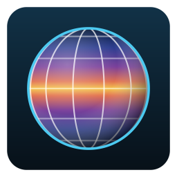
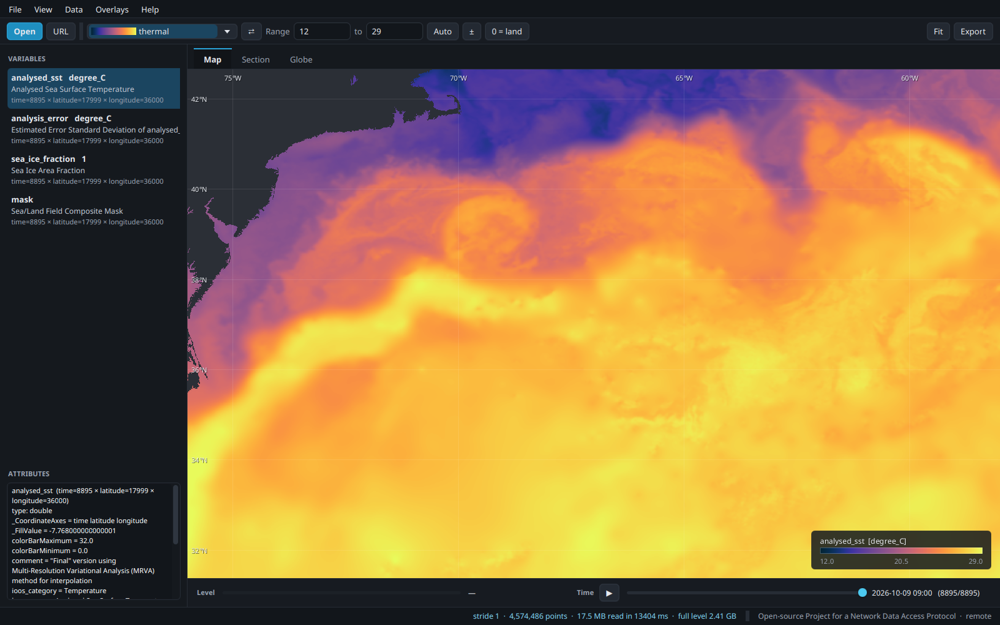
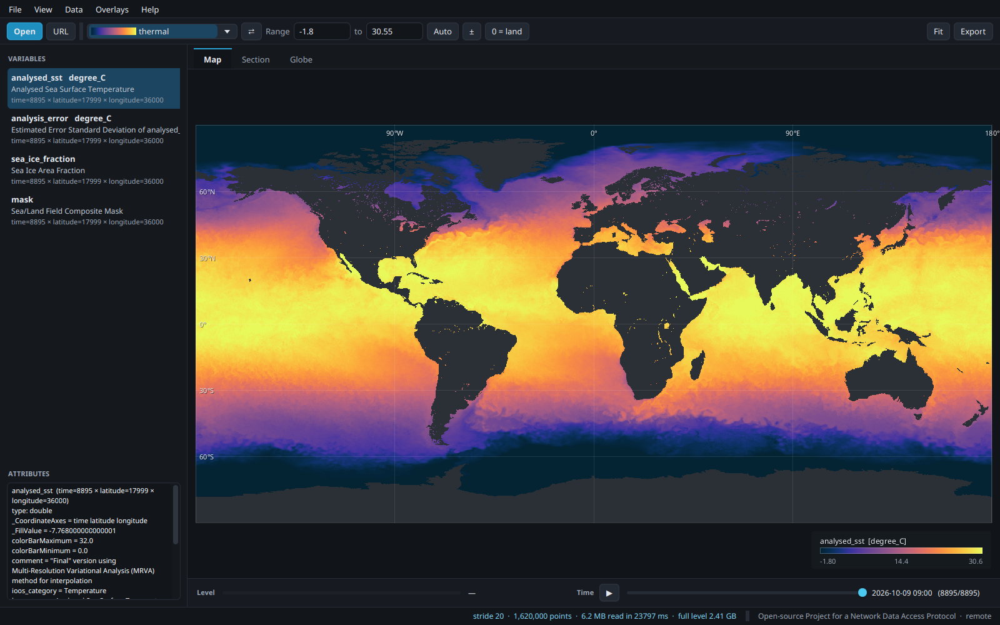
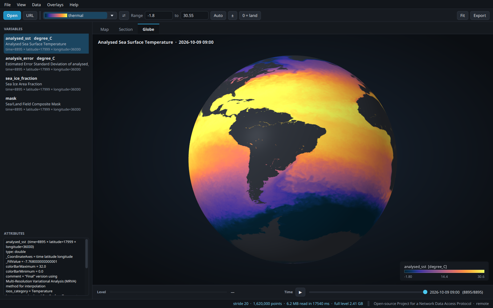
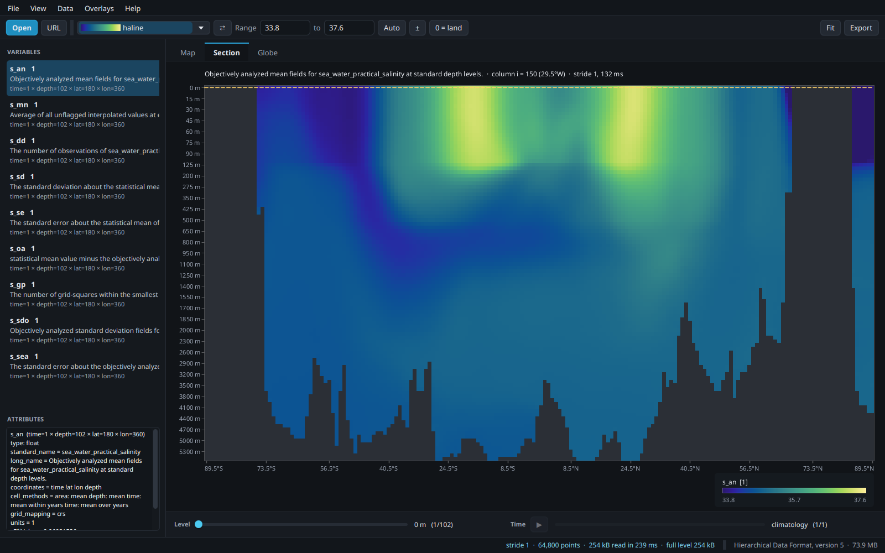
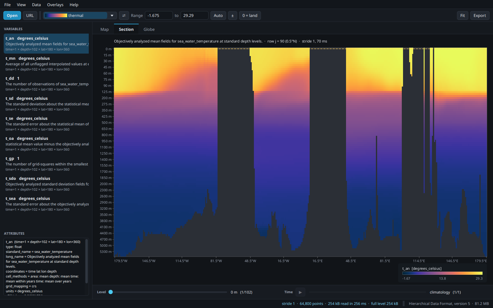
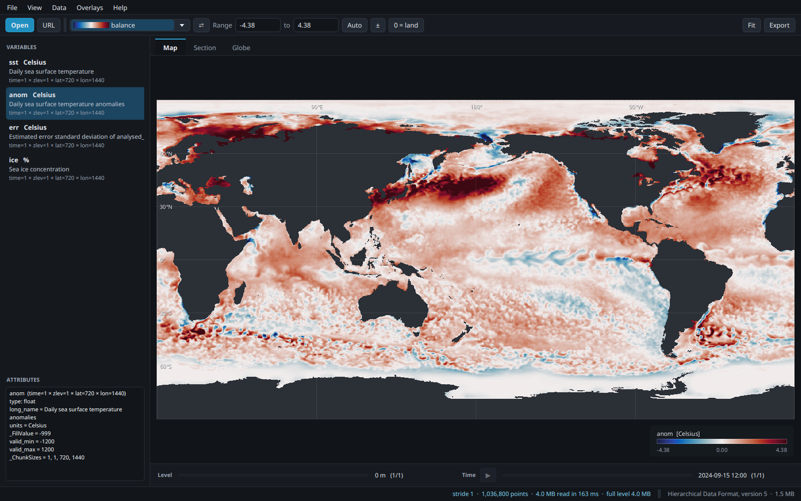
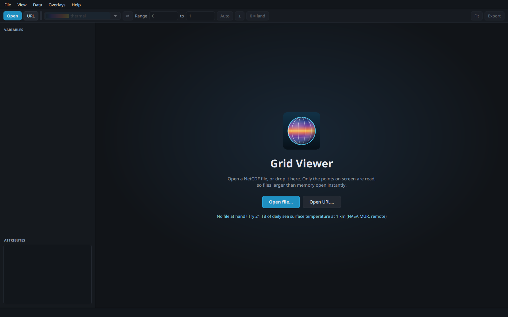

<p align="center">
  
</p>

<h1 align="center">Grid Viewer</h1>

<p align="center">
  <strong>Open NetCDF files and OPeNDAP datasets far larger than memory, instantly.</strong><br>
  Maps, vertical sections and a 3D globe for ocean and climate model outputs.
</p>

<p align="center">
  <a href="https://github.com/laborima/gridviewer/actions/workflows/ci.yml"></a>
  
  
  <a href="LICENSE"></a>
</p>



<p align="center"><em>The Gulf Stream and a warm-core ring on 9 October 2026, at 1 km, streamed from the
21 TB <a href="https://podaac.jpl.nasa.gov/MEaSUREs-MUR">NASA MUR</a> sea surface temperature dataset.
Grid Viewer transferred 17.5 MB to draw it.</em></p>

---

## Why Grid Viewer

Ocean and climate models write grids that do not fit in memory: a global 1/12° model writes
billions of values per day, and satellite products such as MUR SST hold tens of terabytes. Most
viewers load a whole variable, or at least a whole level, before they draw anything.

Grid Viewer **never reads more grid points than your screen has pixels**. A world map of a
36 000 × 18 000 grid on a 1600-pixel-wide window reads one point in twenty in each direction.
Zoom in, and the visible window shrinks, the stride drops, and the missing detail is read, down
to every single point. Pan back out, and it comes from the cache.

| What is on screen | Grid | Read by Grid Viewer | Whole level | Memory |
|---|---|---|---|---|
| World map, MUR SST over OPeNDAP | 36 000 × 17 999 | **6.2 MB** (stride 20) | 2.41 GB | — |
| Gulf Stream at full 1 km resolution | 1 800 × 1 000 window | **17.5 MB** (stride 1) | 2.41 GB | — |
| World map, local 1/24° NetCDF file | 8 640 × 4 320 | **5.7 MB in 0.2 s** (stride 5) | 142 MB in 1.4 s | **170 MB** instead of 1.3 GB |

<sub>Local figures: `gridviewer render` on a 600 MB NetCDF-3 file already in the page cache, whole
process included. The point is not the absolute numbers but that they do not grow with the file.</sub>

This was the idea behind the original Grid Viewer, written in 2006 at
[Mercator Océan](https://www.mercator-ocean.eu) to browse NEMO/OPA model outputs that were
already too big for the workstations of the time. Twenty years later it is rewritten from
scratch for Java 25, with the same trick at its heart.

## Features

- **Huge files, instantly**: only the header is read on opening; values are read one strided
  window at a time, on a dedicated I/O thread, and stale requests are dropped while you zoom.
- **Local and remote**: NetCDF-3, NetCDF-4/HDF5 and **OPeNDAP** URLs (THREDDS, ERDDAP, Hyrax).
  Remotely, the server does the subsetting, so only the points on screen cross the network.
- **Map view** with smooth zoom (wheel, pinch, box zoom), pan, longitude/latitude graticule and
  a read-out of the value, indices and coordinates under the pointer.
- **Vertical sections** along any row or column, by model level or at true depth.
- **3D globe** that the current level wraps around, slowly turning, as the 2006 Java3D view did.
- **Regular and curvilinear grids**: CF coordinates, 2D `nav_lon`/`nav_lat` (NEMO/ORCA),
  descending latitudes, fill values, `valid_range`, packed data, and NEMO's "land is 0".
- **Time and depth navigation** with sliders, keyboard shortcuts and a play button for time
  series. Dates are decoded from CF units, climatologies are recognised.
- **29 colour maps**: [cmocean](https://matplotlib.org/cmocean/) (made for oceanography),
  viridis/cividis/magma/turbo, and the 13 original 2006 palettes. The map is chosen from the
  variable (thermal for temperature, haline for salinity, balance centred on zero for anomalies
  and velocities...), the range is set automatically from what is on screen.
- **Overlays** from the 2006 version: point lists and NEMO `layout.dat` MPI domain decompositions.
- **Command line**: `gridviewer info` to list variables, `gridviewer render` to draw PNG maps from
  scripts, with the same strided reads.
- **Easy to install**: native packages with their own Java runtime for Linux, Windows and macOS.

## Screenshots

| | |
|---|---|
|  |  |
| The whole planet at 1 km, 6.2 MB read | The same day on the globe |
|  |  |
| Salinity along 29.5°W from WOA23: Antarctic Intermediate Water slides north under the subtropical maxima | Temperature along the equator: the thermocline tilting across the Pacific, Atlantic and Indian oceans, and the ridges below |
|  |  |
| NOAA OISST anomaly with a diverging map centred on zero | No file at hand? One click opens the 21 TB MUR dataset |

## Install

Download the package for your system from the
[latest release](https://github.com/laborima/gridviewer/releases/latest). Every package ships its
own Java runtime: **nothing else to install**.

| System | Package | Install |
|---|---|---|
| Debian, Ubuntu, Mint | `gridviewer_2.0.0_amd64.deb` | `sudo apt install ./gridviewer_2.0.0_amd64.deb` |
| Fedora, RHEL, openSUSE | `gridviewer-2.0.0-1.x86_64.rpm` | `sudo dnf install ./gridviewer-2.0.0-1.x86_64.rpm` |
| Any Linux, one file | `GridViewer-2.0.0-x86_64.AppImage` | `chmod +x GridViewer-*.AppImage` and run it |
| Any Linux, snap | `gridviewer_2.0.0_amd64.snap` | `sudo snap install --dangerous gridviewer_2.0.0_amd64.snap` |
| Any Linux, no root | `gridviewer-2.0.0-linux-x64.tar.gz` | extract, run `bin/gridviewer` |
| Windows 10/11 | `Grid Viewer-2.0.0.msi` | double-click; or unzip `gridviewer-2.0.0-windows-x64.zip` |
| macOS (Apple silicon / Intel) | `Grid Viewer-2.0.0-aarch64.dmg` / `-x64.dmg` | open, drag to Applications |

The deb and rpm packages add Grid Viewer to the application menu and open `.nc` files on double-click.
The macOS builds are not notarised yet: the first time, right-click the app and choose *Open*.

## Quick start

Open a file from the menu, drop it on the window, or pass it on the command line:

```sh
gridviewer ocean_model_output.nc
gridviewer https://coastwatch.pfeg.noaa.gov/erddap/griddap/jplMURSST41 --var analysed_sst --time -1
```

No NetCDF file at hand? These public files are small and quick to download:

```sh
# World Ocean Atlas 2023, annual temperature, 1°, 102 depth levels (81 MB, NOAA)
curl -O https://www.ncei.noaa.gov/data/oceans/woa/WOA23/DATA/temperature/netcdf/decav/1.00/woa23_decav_t00_01.nc
# NOAA OISST, one day of sea surface temperature and anomaly, 0.25° (1.5 MB)
curl -O https://www.ncei.noaa.gov/data/sea-surface-temperature-optimum-interpolation/v2.1/access/avhrr/202409/oisst-avhrr-v02r01.20240915.nc
```

### Mouse and keyboard

| Action | Map | Globe |
|---|---|---|
| Zoom | wheel, pinch, `+` `-`, double-click (Alt: out) | wheel |
| Move | drag, arrow keys | drag to rotate |
| Zoom to a box | Shift + drag | |
| Fit | `0`, Ctrl+0 | |
| Vertical section | right-click on the map | |
| Level up / down | Page Up / Page Down | Page Up / Page Down |
| Previous / next time step | Alt+← / Alt+→ | Alt+← / Alt+→ |
| Colour range from what is on screen | Ctrl+R | Ctrl+R |
| Export the view as PNG | Ctrl+E | Ctrl+E |

## Command line

```console
$ gridviewer info woa23_decav_t00_01.nc
woa23_decav_t00_01.nc
  Hierarchical Data Format, version 5, 81.2 MB on disk

  t_an           Objectively analyzed mean fields for sea_water_temperature at standard depth levels. [degrees_celsius]
                 time=1 × depth=102 × lat=180 × lon=360, 25.2 MB as floats
                 102 levels: 0 m .. 5500 m
                 regular lon/lat grid
  ...

$ gridviewer render https://coastwatch.pfeg.noaa.gov/erddap/griddap/jplMURSST41 \
      -v analysed_sst -t -1 -W 1600 -o world.png
analysed_sst: read 1,340,703 of 647,964,000 points (stride 22), 5.1 MB instead of 2.41 GB, in 16165 ms -> world.png
```

`gridviewer render --help` lists the options: level, time step, grid window, colour map, range,
size, and `--full` to read every point for comparison. `gridviewer palettes` lists the colour maps.

## How it works

```
 screen pixels ──► Stride ──► strided read ──► Slice ──► colour map ──► image
                    │        (netCDF-Java,       │
  zoom / pan ───────┘         one I/O thread)    └──► LRU cache (¼ of the heap)
```

- `Stride` picks, for the visible window, the largest step that still gives one sample per
  device pixel. A `Variable.read` with that step returns only those samples, whatever the file
  format or transport.
- The map keeps two layers: a **base** covering the whole grid at a coarse stride, read once per
  level and time step, and a **detail** layer covering the view plus a margin, re-read 60 ms after
  the view stops moving. Meanwhile the previous pixels are stretched, so zooming always feels
  immediate.
- All netCDF reads go through a single I/O thread (netCDF-Java files are not thread safe).
  `LatestOnly` keeps just the newest pending request per view, so a fast zoom or a dragged
  slider never queues up stale reads.
- Slices are cached by request in an LRU bounded to a quarter of the heap, so flipping back to a
  previous level, time step or zoom costs nothing.

The code is small and documented: `data/` reads grids, `render/` turns values into pixels,
`ui/` is the JavaFX application, `cli/` the command line.

## Build from source

You need JDK 25. Maven is fetched by the wrapper.

```sh
./mvnw verify                          # build and run the tests
java -jar target/gridviewer.jar        # run (dependencies are in target/lib)

packaging/package.sh archive deb rpm   # self-contained packages in dist/ (rpm needs rpmbuild)
packaging/appimage.sh                  # AppImage, from the archive
packaging/snap.sh                      # snap, from the archive (needs snapcraft)
```

On Windows run `packaging/package.sh archive msi` from Git Bash (WiX needed), on macOS
`packaging/package.sh archive dmg`. Pushing a `v*` tag builds every package on GitHub Actions and
publishes them as a release.

The README screenshots are reproducible: the viewer accepts `--window`, `--section`, `--tab`,
`--palette`, `--range` and `--screenshot FILE.png`, for instance

```sh
java -jar target/gridviewer.jar woa23_decav_s00_01.nc --var s_an --tab section \
    --section col:150 --range 33.8:37.6 --size 1600x1000 --screenshot section.png
```

## History

Grid Viewer was written in 2005–2006 at Mercator Océan, on spare time, in Java 1.5 with SWT,
NetCDF-Java 2.2 and Java3D. It let oceanographers browse NEMO/OPA outputs on any workstation and
was used long after. The original sources are kept in [`legacy/`](legacy/) and tagged
`legacy-2006`.

Version 2 (2026) is a complete rewrite on Java 25, JavaFX 25 and netCDF-Java 5, keeping what made
the original useful: the strided reads, the vertical sections, the 2006 palettes and default
ranges, point lists, NEMO `layout.dat` overlays, and the turning globe.

## Credits

- [netCDF-Java](https://github.com/Unidata/netcdf-java) by Unidata (BSD-3-Clause) reads every
  format and protocol.
- [OpenJFX](https://openjfx.io) (GPL v2 with Classpath Exception) draws the interface.
- Colour maps: [cmocean](https://github.com/matplotlib/cmocean) by Kristen Thyng et al. (MIT),
  and viridis, cividis, magma, turbo, RdBu and coolwarm from [matplotlib](https://matplotlib.org).
- Data in the screenshots: [MUR SST v4.1](https://doi.org/10.5067/GHGMR-4FJ04) (NASA JPL, served
  by NOAA CoastWatch ERDDAP), [World Ocean Atlas 2023](https://www.ncei.noaa.gov/products/world-ocean-atlas)
  and [OISST v2.1](https://www.ncei.noaa.gov/products/optimum-interpolation-sst) (NOAA NCEI).

## License

[Apache License 2.0](LICENSE). Copyright 2006–2026 Matthieu Laborie.
